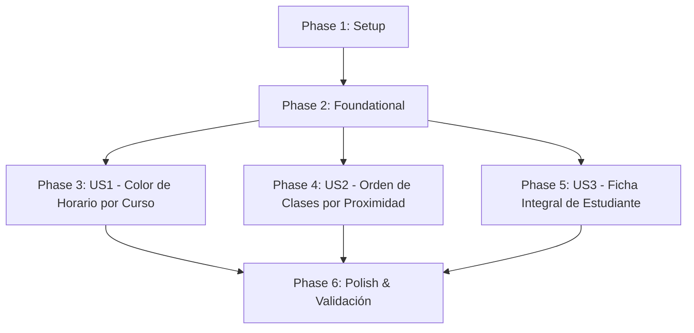

# Tasks: Horario por Curso, Clases Próximas y Ficha Integral de Estudiante

**Input**: Design documents from `specs/011-teacher-schedule-classes-student-profile/`  
**Prerequisites**: `plan.md`, `spec.md`, `research.md`, `data-model.md`, `contracts/endpoints.md`, `quickstart.md`  
**Branch**: `011-teacher-schedule-classes-student-profile`

## Format: `- [ ] [ID] [P?] [Story] Description with file path`

- **[P]**: Can run in parallel (different files, no dependencies)
- **[Story]**: User story identifier ([US1], [US2], [US3])
- Clear, unambiguous file paths in every task

---

## Phase 1: Setup (Shared Infrastructure)

**Purpose**: Preparar los tipos y contratos compartidos en el backend y frontend

- [X] T001 [P] Actualizar la interfaz `CalendarScheduleBlock` en `resources/js/composables/useScheduleCalendar.ts` agregando `courseId?: number` opcional para soportar indexación por curso.
- [X] T002 [P] Extender el serializador `flattenCalendarSessions` en `app/Modules/Scheduling/Infrastructure/Http/SchedulingController.php` para incluir `'courseId' => $offering->course_id`.

---

## Phase 2: Foundational (Blocking Prerequisites)

**Purpose**: Métodos de repositorio y adaptadores de dominio para enriquecimiento de progreso y evaluaciones

- [X] T003 Definir en `app/Modules/Students/Domain/StudentRepository.php` el método `coursesWithProgressAndAssessments(int $studentId, ?int $teacherId = null): array` con su array shape tipado.
- [X] T004 Implementar `coursesWithProgressAndAssessments` en `app/Modules/Students/Infrastructure/EloquentStudentRepository.php` consultando matrículas activas, progreso mediante `LessonCompletion` / módulo Progress y evaluaciones con últimos intentos y calificaciones de `Attempt` / módulo Assessments.

**Checkpoint**: Base de datos y contratos listos. Las historias de usuario pueden implementarse.

---

## Phase 3: User Story 1 - Colorización de Bloques por Curso en Horario Académico (Priority: P1) 🎯 MVP

**Goal**: Asignar colores consistentes por curso a los bloques de sesiones en el calendario semanal de horarios para docentes (`/my/schedule`) y administración (`/scheduling`).

**Independent Test**: Visitar `/my/schedule` con un docente asignado a múltiples asignaturas y comprobar que las sesiones del mismo curso comparten el mismo color, cursos distintos tienen colores diferentes y los textos se leen nítidamente con alto contraste.

### Tests for User Story 1

- [X] T005 [P] [US1] Crear test de integración en `tests/Feature/Scheduling/ScheduleCourseColorTest.php` verificando que `GET /my/schedule` y `GET /scheduling` entregan `courseId` en cada bloque de `calendarBlocks`.

### Implementation for User Story 1

- [X] T006 [US1] Modificar `useScheduleCalendar.ts` en `resources/js/composables/useScheduleCalendar.ts` para mapear colores por `courseId` (o `courseName` como fallback) en lugar de `teacherId`, generando la leyenda `courseLegend` por asignaturas.
- [X] T007 [US1] Ajustar la vista `resources/js/pages/Scheduling/MySchedule.vue` y `resources/js/pages/Scheduling/Index.vue` para asegurar renderizado de bloques de FullCalendar con colores por curso y contraste óptimo (texto blanco sobre fondo saturado accesible).

**Checkpoint**: User Story 1 operativa de manera independiente.

---

## Phase 4: User Story 2 - Ordenamiento de Clases Docentes por Proximidad de Inicio (Priority: P2)

**Goal**: Mostrar las tarjetas de cursos en `/my/classes` ordenadas cronológicamente con la oferta más próxima a iniciar en primer lugar.

**Independent Test**: Asignar a un docente ofertas con fechas de inicio futuras y pasadas, ingresar a `/my/classes` y validar que la primera tarjeta visible corresponde a la clase cuyo inicio es más cercano a hoy.

### Tests for User Story 2

- [X] T008 [P] [US2] Crear test de feature en `tests/Feature/Scheduling/TeacherClassOrderTest.php` comprobando que `GET /my/classes` devuelve las ofertas ordenadas cronológicamente por `starts_on ASC` (priorizando fechas activas/próximas).

### Implementation for User Story 2

- [X] T009 [US2] Modificar la consulta de ofertas en `app/Modules/Scheduling/Infrastructure/Http/TeacherClassController.php` agregando ordenamiento `orderByRaw("CASE WHEN starts_on >= CURRENT_DATE THEN 0 ELSE 1 END")` y `orderBy('starts_on', 'asc')` con fallback en `orderBy('id', 'asc')`.
- [X] T010 [US2] Actualizar `resources/js/pages/Teacher/Classes.vue` para asegurar la presentación fluida de los metadatos de inicio y horario en las tarjetas de clases ordenadas.

**Checkpoint**: User Stories 1 y 2 operativas e independientes.

---

## Phase 5: User Story 3 - Ficha Integral de Estudiante con Progreso y Evaluaciones (Priority: P3)

**Goal**: Permitir al docente y administrador ver en `/students/{studentId}` los datos del alumno, y para cada curso matriculado, su barra de progreso y el desglose de evaluaciones con sus notas obtenidas.

**Independent Test**: Iniciar sesión como docente asignado al estudiante, navegar a `/students/{studentId}` y constatar que cada curso matriculado muestra su porcentaje de avance y sus evaluaciones con notas e intentos calificados.

### Tests for User Story 3

- [X] T011 [P] [US3] Crear test de feature en `tests/Feature/Students/StudentProfileIntegratedProgressTest.php` verificando que `GET /students/{id}` incluye `progress` y `assessments` en la lista de cursos para admin y docente autorizado (`canTeacherView`), y responde 404 para docente no asignado.

### Implementation for User Story 3

- [X] T012 [US3] Actualizar el método `show` en `app/Modules/Students/Infrastructure/Http/StudentController.php` para utilizar `coursesWithProgressAndAssessments` del repositorio en lugar de `coursesFor`.
- [X] T013 [US3] Rediseñar la sección de cursos en `resources/js/pages/Students/Show.vue` implementando tarjetas integradas por curso con:
  - Encabezado de curso y código de grupo.
  - Barra de progreso formativo con porcentaje y ratio de lecciones (`X / Y lecciones`).
  - Tabla o listado compacto de evaluaciones del curso con título, puntaje obtenido sobre total (`score / total_score`), badge de estado (Aprobado / Desaprobado / Pendiente) y fecha de entrega.
  - Mensaje descriptivo cuando no hay evaluaciones rendidas en el curso.

**Checkpoint**: Todas las historias de usuario implementadas y verificables.

---

## Phase 6: Polish & Cross-Cutting Concerns

**Purpose**: Verificación integral, formato de código y ejecución de pruebas de regresión

- [X] T014 [P] Formatear código PHP modificado ejecutando `vendor/bin/pint --dirty --format agent`.
- [X] T015 [P] Ejecutar la suite de pruebas del proyecto (`php artisan test --filter=Schedule|TeacherClass|StudentProfile`).
- [X] T016 Ejecutar validación de escenarios descritos en `specs/011-teacher-schedule-classes-student-profile/quickstart.md`.

---

## Dependencies & Execution Order

### Phase Dependencies

- **Phase 1 (Setup)** y **Phase 2 (Foundational)** deben completarse antes de iniciar cualquiera de las historias de usuario.
- **US1, US2 y US3** son independientes entre sí y pueden implementarse en paralelo o secuencialmente según prioridad (P1 → P2 → P3).
- **Phase 6 (Polish)** corre al finalizar las 3 historias de usuario.

---

## Implementation Strategy (MVP First)

1. **MVP**: Ejecutar Setup (T001-T002), Foundational (T003-T004) y User Story 1 (T005-T007). Probar `/my/schedule` de forma independiente.
2. **Incremento 2**: Implementar User Story 2 (T008-T010). Probar `/my/classes`.
3. **Incremento 3**: Implementar User Story 3 (T011-T013). Probar `/students/{studentId}`.
4. **Cierre**: Ejecutar Pint, suite completa y quickstart (T014-T016).
