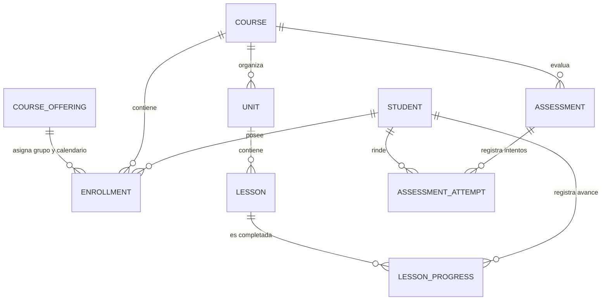
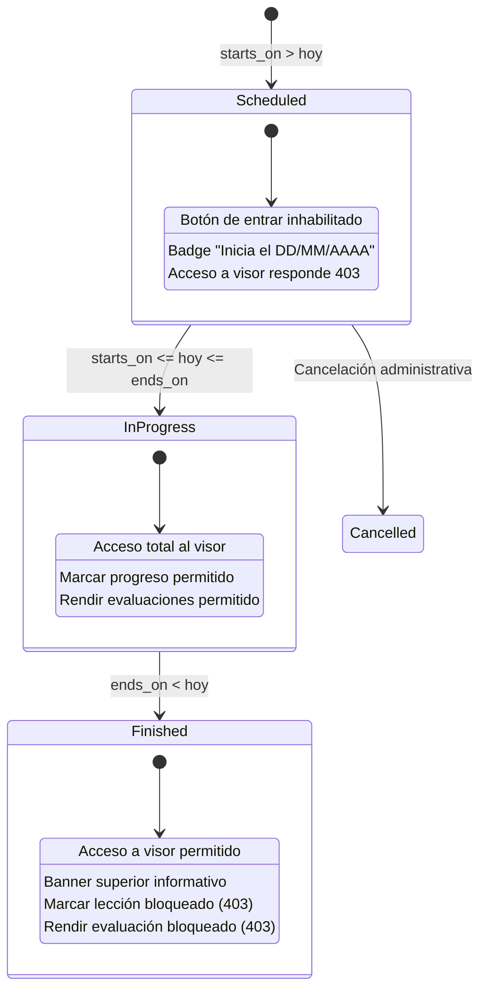

# Data Model & State Transitions: Módulo de Mis Clases del Estudiante

## Entidades y Relaciones



## Estados de la Oferta / Clase para el Estudiante



## Propiedades de la Clase para el Estudiante (`StudentClassItem`)

```typescript
export interface StudentClassItem {
    id: number; // enrollment_id o offering_id
    offering_id: number;
    course_id: number;
    course_name: string;
    group_code: string;
    modality: string;
    cover_url: string;
    units_count: number;
    teachers: { id: number; name: string }[];
    starts_on: string | null;
    ends_on: string | null;
    status: 'scheduled' | 'in_progress' | 'finished' | 'cancelled';
    can_access: boolean; // starts_on <= hoy
    is_finished: boolean; // ends_on < hoy
    progress: {
        completed_lessons: number;
        total_lessons: number;
        percentage: number;
    };
}
```

