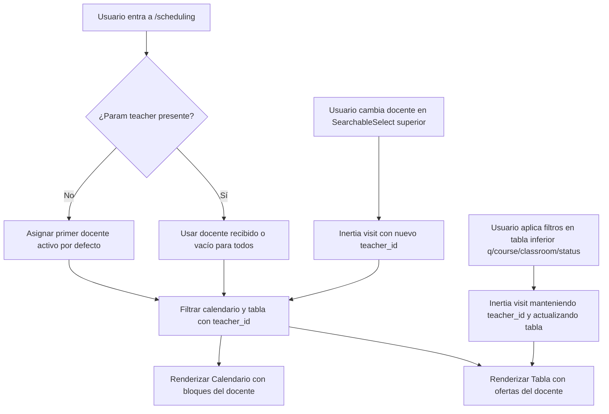

# Data Model & State Flow: Programación Académica Basada en Docente

## Entidades Relevantes

### 1. User (Docente)
- `id`: number
- `name`: string
- Rol: `docente`
- `is_active`: boolean (true)

### 2. CourseOffering (Oferta / Grupo)
- `id`: number
- `course_id`: number
- `group_code`: string
- `starts_on`: string (YYYY-MM-DD)
- `ends_on`: string (YYYY-MM-DD)
- `max_students`: number
- `modality`: `'in_person' | 'virtual' | 'hybrid'`
- `status`: `'draft' | 'published' | 'in_progress' | 'finished' | 'cancelled'`
- Relaciones:
  - `teachers`: Colección de `User` asignados como docentes.
  - `sessions`: Colección de `CourseSession`.

### 3. CourseSession (Sesión de Clase)
- `id`: number
- `course_offering_id`: number
- `teacher_id`: number
- `classroom_id`: number | null
- `session_date`: string (YYYY-MM-DD)
- `starts_at`: string (HH:MM)
- `ends_at`: string (HH:MM)
- `status`: `'scheduled' | 'in_progress' | 'finished' | 'cancelled'`

## Flujo de Estado y Parámetros en `/scheduling`

