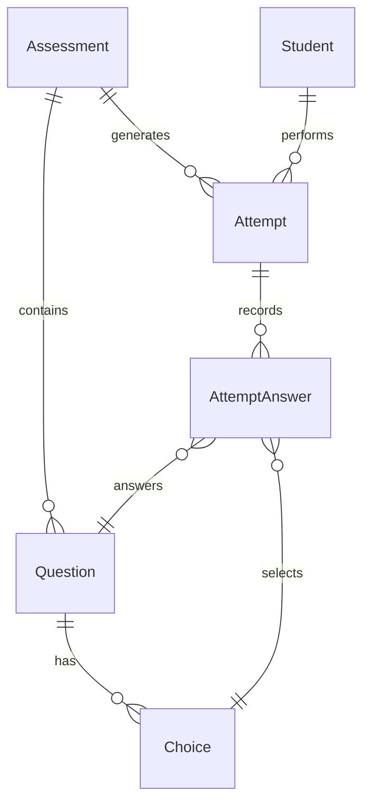

# Data Model: Navegación de Calendario y Revisión de Evaluaciones

## Estructura de Datos para `Assessments/Review.vue`



### Entidades y Atributos en Review

#### Assessment
- `id`: number
- `title`: string
- `instructions`: RichTextDocument | null
- `total_score`: number
- `passing_score`: number

#### Attempt (Intento del Alumno)
- `id`: number
- `attempt_number`: number
- `status`: `'in_progress' | 'completed' | 'abandoned'`
- `score`: number
- `passed`: boolean
- `started_at`: string
- `submitted_at`: string | null

#### Question & Answer Payload (Estructura Serializada)
```typescript
interface ReviewQuestion {
    id: number;
    statement: RichTextDocument;
    score: number;
    choices: {
        id: number;
        text: string;
        is_correct?: boolean; // Solo visible si attempt.status === 'completed'
    }[];
    student_answer: {
        choice_id: number | null;
        is_correct?: boolean;
    } | null;
}
```

