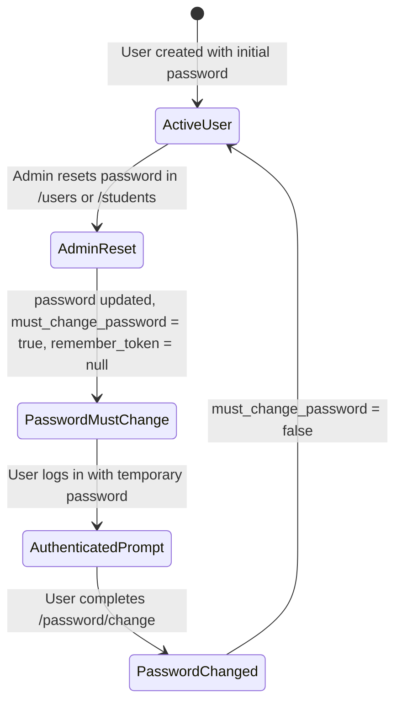

# Data Model: Admin Password Reset and Public Recovery Removal

**Feature Branch**: `017-admin-password-reset`  
**Date**: 2026-11-05  
**Spec Reference**: `specs/017-admin-password-reset/spec.md`  
**Obsidian Note**: `[[REQ-028 - Restablecimiento de Contraseña Exclusivo por Administrador y Eliminación de Recuperacion en Login]]`

---

## 1. Entity Attributes and Password Reset State Transitions

### `User` Entity Lifecycle upon Admin Reset



### Table Columns Affected

| Table | Column | Type | State on Admin Reset |
|---|---|---|---|
| `users` | `password` | `VARCHAR(255)` | Updated with `Hash::make($newPassword)` |
| `users` | `must_change_password` | `BOOLEAN` | Set to `true` |
| `users` | `remember_token` | `VARCHAR(100)` | Cleared (`null`) |

---

## 2. Updated Domain Model Contracts

### `App\Modules\Students\Domain\StudentRepository`
```php
public function update(
    int $studentId,
    string $name,
    string $username,
    ?string $email,
    string $identifier,
    string $birthDate,
    ?string $passwordHash = null,
    ?string $phone = null,
): void;
```

### `App\Modules\Identity\Domain\UserRepository`
```php
public function update(
    int $id,
    string $name,
    string $email,
    ?string $passwordHash = null,
    bool $mustChangePassword = false,
): void;
```

