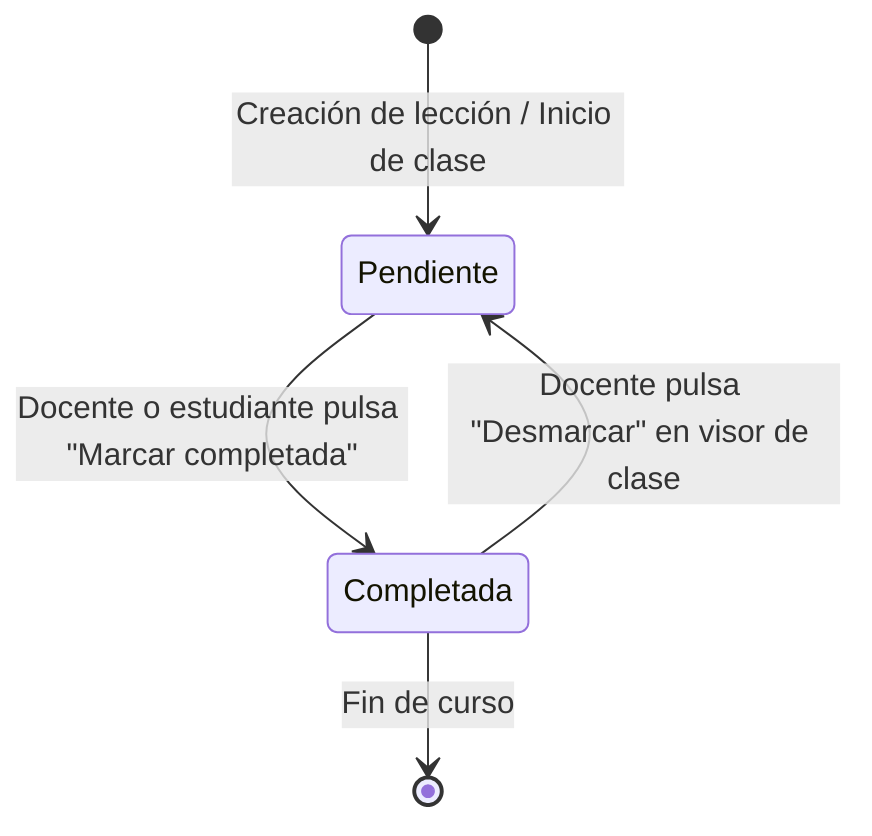

# Data Model: Marcado de Lección Completada y Reanudación de Avance para Docentes

**Feature**: `019-teacher-lesson-completion-resume`
**Date**: 2026-11-16

## 1. Esquema de Base de Datos

### Tabla: `lesson_progress` (Modificada)

| Columna | Tipo | Nulable | Descripción |
| :--- | :--- | :--- | :--- |
| `id` | `BIGSERIAL PRIMARY KEY` | No | Identificador único del registro de progreso. |
| `student_id` | `BIGINT UNSIGNED` | Sí | FK a `students(id)`. Presente en avance de estudiante individual. |
| `user_id` | `BIGINT UNSIGNED` | Sí | FK a `users(id)`. Usuario que completó o dictó la lección. |
| `course_offering_id` | `BIGINT UNSIGNED` | Sí | FK a `course_offerings(id)`. Presente cuando la lección es dictada en una oferta/clase específica. |
| `lesson_id` | `BIGINT UNSIGNED` | No | FK a `lessons(id)`. Lección completada. |
| `completed_at` | `TIMESTAMP` | No | Fecha y hora en la que se registró la completitud. |
| `created_at` | `TIMESTAMP` | No | Timestamp de creación. |
| `updated_at` | `TIMESTAMP` | No | Timestamp de actualización. |

#### Restricciones e Índices:
- `UNIQUE ('student_id', 'lesson_id')` (existente para estudiantes)
- `UNIQUE ('user_id', 'lesson_id')` (existente para usuarios directos)
- `UNIQUE ('course_offering_id', 'lesson_id')` (nuevo: una oferta de clase registra como máximo una completitud por lección)
- `INDEX ('course_offering_id')`

---

## 2. Entidades de Dominio

### LessonProgressRecord (Value Object / Record)
```php
namespace App\Modules\Progress\Domain;

final class LessonProgressRecord
{
    public function __construct(
        public readonly int $id,
        public readonly ?int $studentId,
        public readonly ?int $userId,
        public readonly ?int $courseOfferingId,
        public readonly int $lessonId,
        public readonly string $completedAt,
    ) {}
}
```

---

## 3. Estados y Transiciones de Lección



### Reglas de Negocio:
1. **Docente en clase (`/my/classes/{offering}/viewer`)**:
   - Solo docentes formalmente asignados a la oferta (`course_offering_teacher`) o usuarios con `courses.manage` pueden marcar o desmarcar lecciones de la oferta.
   - El avance completado impacta el visor de esa oferta académica (`course_offering_id`).
2. **Estudiante en curso (`/my/courses/{course}`)**:
   - El estudiante solo puede marcar como completada si tiene matrícula activa y el curso no está finalizado.
   - El avance de estudiante es personal (`student_id`).
3. **Reanudación del Visor**:
   - Al cargar el visor, se obtienen las lecciones ordenadas por unidad y posición.
   - Se localiza la última lección con `is_completed === true`.
   - Si existe, el visor se inicializa en dicho índice; si ninguna está completada, se inicializa en el índice 0.

